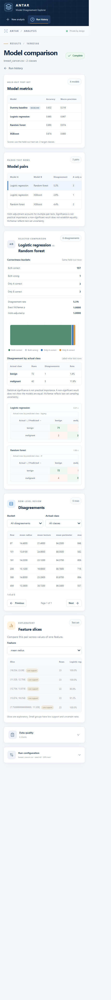

# ANTAR — Model Disagreement Explorer

ANTAR is a local tool for comparing classification models on the same held-out rows. It reports performance, paired prediction disagreements, and the feature slices where models differ. It is an exploratory aid, not AutoML or a claim that one model is universally best.



## Run locally with Docker

Install Docker Desktop, then from the repository root:

```powershell
docker compose up --build
```

Open [http://127.0.0.1:8080](http://127.0.0.1:8080). The built-in Breast Cancer sample is a quick binary-classification demo. Stop the services with `Ctrl+C`; run `docker compose down` to remove the containers. Run files persist in the ignored `data/` directory across restarts.

The backend is not published as a host port. Nginx serves the frontend and proxies `/api/` over Compose's private network. The browser port is bound to loopback only. Do not expose this unauthenticated, local-only app to an untrusted network.

## Demo datasets

- **Binary:** the built-in Breast Cancer sample.
- **Multiclass:** the Wine dataset from `sklearn.datasets.load_wine`; export it as a CSV with `target` as the label.
- **Real data:** UCI Adult (Census Income), which has numeric and categorical features and missing values. Use `?` as an explicit feature-missing token; the app does not guess missing-value markers.

The UCI datasets are not bundled. The Adult source is [UCI's dataset page](https://archive.ics.uci.edu/dataset/2/adult), DOI [10.24432/C5XW20](https://doi.org/10.24432/C5XW20). Check the source page for attribution and reuse terms. Local uploads and generated run records are excluded from Git.

## Architecture

```text
Browser → Nginx (static React app; /api proxy)
                    ↓
          FastAPI (one Uvicorn worker)
                    ↓
          Python analysis core
          ├── CSV profile, split, train-only diagnostics
          ├── model pipelines and paired statistics
          └── file-backed runs and one background worker
```

## Design choices

- Persist the reviewed split so all models use identical test-row IDs.
- Fit imputers, encoders, and scaling inside model pipelines on training rows only.
- Keep missing-value tokens explicit; a label such as `NA` is not silently discarded.
- Report duplicates and conflicting labels instead of altering the input.
- Require a user decision for suspicious integer identifiers.
- Use exact McNemar tests and Holm adjustment for model-pair comparisons.
- Treat slices as exploratory and show low-support warnings.
- Use one worker and a non-blocking lock; reject a second run rather than queue it.

## Findings and measurements

On a 4,000-row UCI Adult extract with 554 explicit `?` markers, logistic regression and random forest each reached 0.84375 accuracy; the decision tree reached 0.81500. With an 800-row held-out set, the decision-tree/random-forest exact McNemar p-value was 0.034615, but its Holm-adjusted value was 0.103846. No model pair was significant after Holm adjustment at 0.05. This is one split, not evidence that the models are equivalent. The full protocol and the separate Covertype results are in [the findings report](docs/findings-draft.md).

The following local `TestClient` timings are workflow measurements, not production benchmarks:

| Adult workflow step | Time |
|---|---:|
| Upload and profile | 0.249 s |
| Split | 0.244 s |
| Complete run | 5.724 s |

Compose API timings and the briefly sampled memory observation are in the findings report, with their limitations. Measurements were taken on Windows 11 Home Single Language, Intel Core i3-10110U at 2.10 GHz, 7.84 GiB RAM. Docker Desktop reports 4 CPUs and 3.75 GiB available to its VM; this is not a per-container memory limit.

## Limitations

- One split per run; rankings can change with another seed or sample.
- Fixed model set and default parameters; this is not a tuning or AutoML system.
- Slices show where predictions differ, not why a model made a prediction.
- No authentication, run cancellation, or support for grouped/time-ordered data.
- Class weighting and paired bootstrap intervals are S-priority items and are not available in this version.

## Development

```powershell
py -3.11 -m venv .venv
.\.venv\Scripts\python.exe -m pip install --no-deps -r backend\requirements.lock
Set-Location backend
..\.venv\Scripts\python.exe -m pytest -q

Set-Location ..\frontend
npm ci
npm run lint
npm run build
```

## License and data

Use the license and attribution terms attached to each dataset. UCI Adult and Covertype files, derived extracts, uploads, and run artifacts are validation inputs, not committed project assets.
