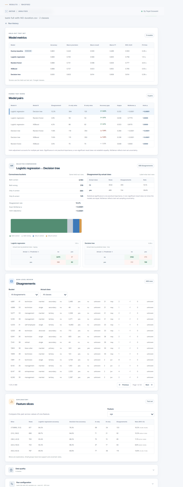

# Model Disagreement Explorer (ANTAR)

A small tool that compares classification models on a CSV file and shows the rows where they disagree.

Two models can have the same accuracy and still make mistakes on different rows. This tool shows those rows and checks whether the difference is real or just chance. It does not pick a model for you. It gives you evidence to choose with.



## What I found

I ran it on three public datasets (seed 42, 20% test rows).

- **Adult Census Income:** logistic regression and random forest differ by only 0.8 points in accuracy (not significant, Holm p = 0.12), but they give different answers on 9.3% of the test rows. XGBoost was the best: accuracy 0.869, macro-F1 0.811.
- **Bank Marketing:** the `duration` column is only known after the phone call, so I ran the data with and without it. Dropping it cut XGBoost's ROC-AUC from 0.928 to 0.765. Without `duration`, Logistic Regression, Random Forest and XGBoost achieved 0.888-0.889 accuracy, close to the 0.883 majority-class baseline, while Decision Tree achieved 0.830. Macro-F1 and ROC-AUC showed that the other models captured useful predictive signal beyond the majority-class baseline.
- **Wine:** the multiclass case works, but the test set has only 36 rows, so I make no claim about which model is better.

## What it does

1. Upload a CSV (up to 20 MB) and pick the column to predict.
2. Make one train/test split and save it, so every model is tested on exactly the same rows.
3. Train Logistic Regression, Decision Tree, Random Forest and XGBoost with default settings, plus a baseline that always predicts the most common class.
4. Show accuracy, macro precision, recall and F1, and ROC-AUC. For every pair of models, show how often they disagree, McNemar's exact test (with Holm correction) and Cohen's kappa.
5. List the rows where two models disagree, and show which feature ranges have more disagreement.

## Run it

With Docker:

```
docker compose up --build
```

Then open http://127.0.0.1:8080

Without Docker:

```
cd backend
python -m venv .venv
source .venv/bin/activate        # on Windows: .venv\Scripts\activate
pip install -r requirements.lock
uvicorn api.main:app --reload

cd frontend                      # in a second terminal
npm install
npm run dev
```

Tests: `cd backend && pytest`

## How to use it

1. Open **New analysis**, drop your CSV or press **Try the sample**.
2. Check the profile. If you see only one column, your file probably uses `;` instead of commas.
3. Choose the target column, a seed and a test size, then **Create split**.
4. In **Review features**, look at any flagged columns and the data quality report.
5. Pick 2 to 4 models and press **Start comparison**.

## How it works

- The split is made first and saved. Anything the tool learns from the data (which columns look like IDs, medians for filling gaps, scaling) comes from the training rows only. The test rows are never used for any decision.
- Missing numbers get the median, missing text gets the most common value, text columns are one-hot encoded (at most 20 categories per column), and only logistic regression is scaled.
- The tool never cleans data silently. Everything it changes is listed in the data quality report. Only empty cells count as missing; values like `NA` stay as text unless you list them as missing.
- McNemar's test only looks at rows where exactly one of the two models is right, because the other rows say nothing about which model is better. Holm correction is used because several pairs are tested at once. Slice rates come with Wilson confidence intervals.

## Results

Adult (20,000-row sample, 4,000 test rows):

| Model | Accuracy | Macro-F1 | ROC-AUC |
|---|---|---|---|
| Baseline | 0.759 | 0.432 | 0.500 |
| Logistic regression | 0.848 | 0.775 | 0.903 |
| Random forest | 0.855 | 0.791 | 0.902 |
| XGBoost | 0.869 | 0.811 | 0.925 |
| Decision tree | 0.814 | 0.750 | 0.755 |

Bank (20,000-row sample, 4,000 test rows), accuracy / macro-F1 / ROC-AUC:

| Model | With `duration` | Without `duration` |
|---|---|---|
| Baseline | 0.883 / 0.469 / 0.500 | 0.883 / 0.469 / 0.500 |
| Logistic regression | 0.898 / 0.696 / 0.906 | 0.889 / 0.605 / 0.758 |
| Random forest | 0.901 / 0.700 / 0.927 | 0.888 / 0.626 / 0.777 |
| XGBoost | 0.905 / 0.750 / 0.928 | 0.888 / 0.652 / 0.765 |
| Decision tree | 0.873 / 0.684 / 0.678 | 0.830 / 0.608 / 0.614 |

Both Bank runs use exactly the same test rows. I only removed `duration`, and only because the dataset's own documentation says it should not be used for a realistic model. I did not remove features based on test results. For Adult and Wine I removed nothing.

## Limitations

- Classification on CSV files only (2 to 10 classes). No regression.
- One split and one seed per run, so the ranking can change with a different seed.
- McNemar's test is about accuracy only. I do not give confidence intervals for macro-F1 differences.
- The tool cannot notice leakage that comes from what a column means, like `duration`. A person has to spot that.
- A default decision tree grows until its leaves are pure, so it always says "100% confident". That is not real certainty.
- Files with more than 20,000 rows are sampled down to 20,000.
- The Adult data has `sex` and `race` columns. I kept them as given and did no fairness analysis, so do not use these models for real decisions about people.
- It runs on your own machine only. There is no login, so do not put it on the internet.

## Datasets

- Adult: Becker and Kohavi, UCI Machine Learning Repository, https://doi.org/10.24432/C5XW20
- Bank Marketing: UCI Machine Learning Repository, https://archive.ics.uci.edu/dataset/222/bank
- Wine and Breast Cancer Wisconsin (the built-in sample): from scikit-learn, https://archive.ics.uci.edu/dataset/109/wine
  
The datasets are not in this repo. Check each dataset's terms before sharing the files.

## Built with

Python, FastAPI, scikit-learn, XGBoost, pandas, SciPy, React, Docker, pytest.

### Tested On
- CPU: Intel Core i3-10110U @ 2.10 GHz
- RAM: 8 GB (7.84 GB usable)
- OS: Windows 11 Home Single Language, 64-bit (Version 25H2)
- Execution: CPU-based, no dedicated GPU

Payal Goswami | [LinkedIn](https://www.linkedin.com/in/payal-goswami97/) |
